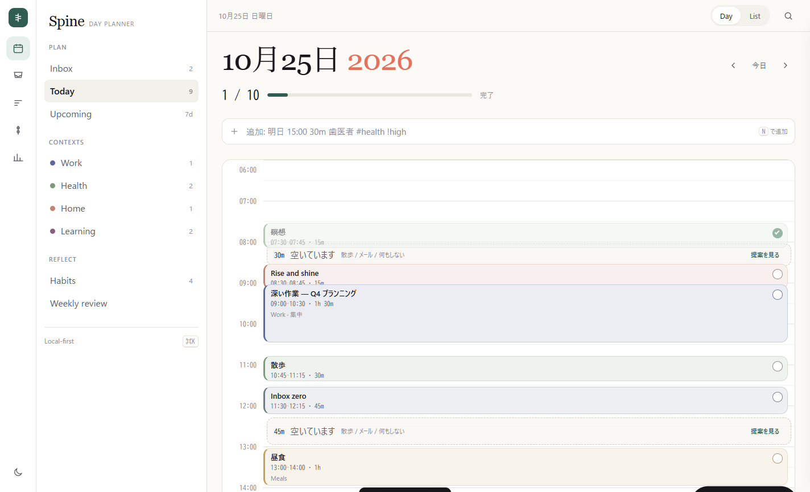
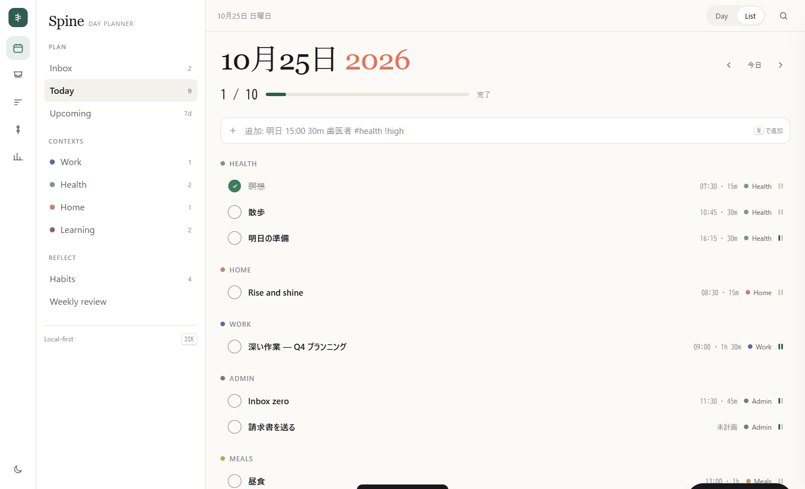
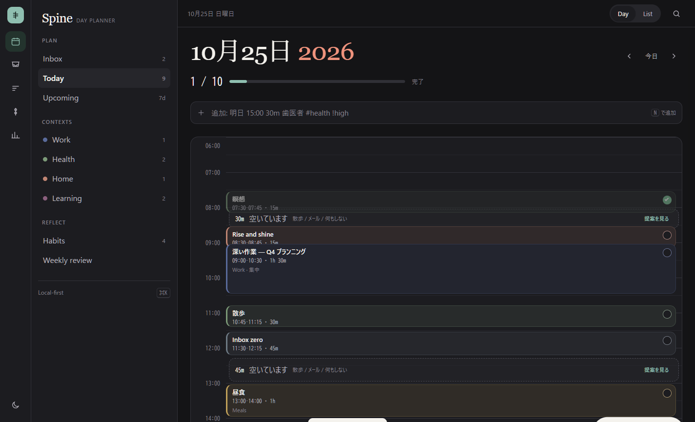
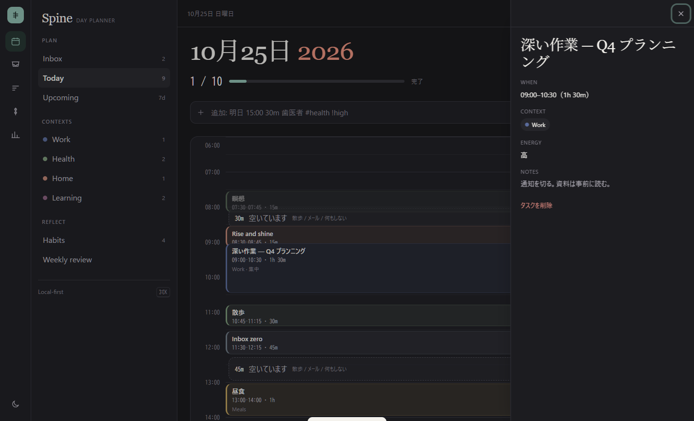

# todo-app-REA

Asana / Toggl / Habitica / Tiimo / Structured —— 5つの「タスク・時間・習慣」プロダクトのUIを、
実際に配信されているHTML・CSS・JavaScriptと公式プロダクト画像からリバースエンジニアリングした調査リポジトリ。

> 目的は模倣ではなく、**「なぜそのUIがその形なのか」を証拠から復元し、自分たちのTodoアプリの設計判断に使える形にする**こと。

---

## 1. 一行でわかる5アプリの正体

| アプリ | UIの正体 | 中心にあるオブジェクト | ホーム画面 |
|---|---|---|---|
| **Asana** | 組織の仕事を構造化する「Work OS」 | プロジェクト / タスク / カスタムフィールド | テーブル（List） |
| **Toggl** | 時間を金額と稼働に変換する「時間の台帳」 | タイムエントリ / プロジェクト | タイマーとレポート |
| **Habitica** | 習慣をRPGの進行に変換する「ゲーム」 | 習慣 / デイリー / ToDo / 報酬 | 4列ボード + HUD |
| **Tiimo** | 認知負荷を下げる「視覚的プランナー」 | ルーティン / 時間ブロック | 週グリッド / 縦タイムライン |
| **Structured** | 1日の連続した時間を可視化する「day spine」 | 時間ブロック | 縦タイムライン |

※ ユーザー指定の「Timo」は、対象プロダクトの正式表記 **Tiimo**（`tiimoapp.com`）と同定した。

---

## 2. いちばん重要な発見（要約）

1. **5アプリは「タスク」を別物として設計している。**
   Asanaのタスクは*合意形成の単位*、Togglのタスクは*時間を消費する単位*、Habiticaのタスクは*成長の単位*、
   Tiimoのタスクは*1日の枠*、Structuredのタスクは*時間軸上の区間*。UIの差はこのモデル差からほぼ説明できる。

2. **時間軸を持つプロダクトは、必ず「空き時間」をUIに出している。**
   Togglは `8h / day` と `3h over capacity`、Structuredは `30min of free time?`、
   Tiimoは `29:51 left`。空きは空白ではなく*操作可能なオブジェクト*。

3. **チェックボックスの形は思想を表す。**
   Asana = 円＋チェック（完了は緑で塗る）、Habitica = 左端の色帯＋±ステッパー、
   Tiimo = 円形リング、Structured = 右端の細い円、Toggl = 再生/停止。
   「完了」の定義が違うので、同じチェックボックスを使ってはいけない。

4. **タイポグラフィの差がブランドの差になっている。**
   Asana 102px / TWK Lausanne 300、Toggl 74.76px / Aeoniksoft、Habitica 56px / Varela Round、
   Tiimo 56px / Recoleta（セリフ）、Structured 78px / Inter 300 + `-4px` tracking。
   *同じ「タスクアプリ」でも、書体だけで全く別のプロダクトに見える。*

5. **色の使い方は3類型に分かれる。**
   ① モノクロ + 1アクセント（Asana, Structured）、② ブランド色 + カテゴリ色（Toggl, Tiimo）、
   ③ 世界観そのものが色（Habitica）。③は色を減らすと成立しない。

---

## 3. 成果物

| パス | 内容 |
|---|---|
| `docs/00-comparative-matrix.md` | 5アプリ横断の比較表（20軸） |
| `docs/01-asana.md` | Asana UI分解 |
| `docs/02-toggl.md` | Toggl UI分解 |
| `docs/03-habitica.md` | Habitica UI分解 |
| `docs/04-tiimo.md` | Tiimo UI分解 |
| `docs/05-structured.md` | Structured UI分解 |
| `docs/06-synthesis.md` | 5アプリから抽出した設計原則とデザインシステム |
| `docs/07-reconstruction-spec.md` | 実装可能な再構築仕様（IA・状態・コンポーネント契約・受入基準） |
| `docs/08-gallery.md` | 主要スクリーンショットのインデックス |
| `METHOD.md` | 調査手法・再現手順・限界 |
| `NOTICE.md` | 権利表記 |
| `design/tokens.json` | 実測トークン + 合成後のセマンティックトークン |
| `design/tokens.css` | CSSカスタムプロパティ実装 |
| `demo/index.html` | 合成デザインシステムで動くTodoプロトタイプ |
| `evidence/` | 全スクリーンショット・DOM/CSS監査・REA Evidence |
| `tools/` | 再現用のキャプチャ/監査スクリプト |

### プロトタイプ

`demo/index.html` は `design/tokens.css` を使った動作可能なデモ（依存なし・単一ファイル）。
Day / List ビュー、タスク追加（自然言語パース）、完了とUndo、空き時間の提案、集中タイマー、
詳細ドロワー、ライト/ダーク、キーボード操作（`N` `1` `2` `T` `Esc`）を含む。

| Day (light) | List (light) |
|---|---|
|  |  |

| Day (dark) | Detail (dark) |
|---|---|
|  |  |

---

## 4. エビデンス

- **102枚のスクリーンショット**（5アプリ / 13ページ / セクション別 + 全ページ）
- **18件のREA Evidenceレコード**（`inspect_web_page` 13件 + `analyze_web_bundle` 5件）
- 実測した computed style（色・書体・余白・角丸・影）をJSONで保存
- すべて `evidence/manifest.json` に SHA-256 付きで記録

REA Evidence IDの例:

```
asana       inspect  ev_713a292912ca5f9f6b9ed9aea6282a0d10c305e526f96366bc5db471886b4fc7
asana       bundle   ev_3eff1be6f60d5ccc197c44c9aafd971d12b97b4a22c68f815c533d124efbae9e
toggl       inspect  ev_3ba266937a111c3ef5e7dc7149c5e18330c4c3cb6c2ac337616e76db5f9a1ae9
habitica    bundle   ev_606e87a73b0ab371e5824227b623d8940c7ac7f513141a4951fa433f797d791c
tiimo       inspect  ev_bdba93f48c6c1f192ae5d441a5517d002d94b5583180148d9d6a91117d99c523
structured  bundle   ev_496f8dfad3b8e025076a5f03ecf5a83f56a6503df8cee8e92e636e9c3552c9f4
```

全IDは [`evidence/MANIFEST.md`](evidence/MANIFEST.md) を参照。
一覧UIは `evidence/gallery.html`（ローカルで開く）で閲覧できる。

---

## 5. 証拠の境界（重要）

| 区分 | 内容 |
|---|---|
| **Observed** | 公開マーケティングサイト、ログイン画面、そこに埋め込まれた公式プロダクト画像、DOM/CSS、JSバンドル |
| **Not observed** | ログイン後の実アプリ画面（アカウント未作成）、課金画面、通知、ネイティブアプリの実機操作 |
| **Inferred** | ログイン後の挙動、状態遷移、マイクロインタラクションの一部 |

REAの原則に従い、各記述は `[OBS]`（実測）/ `[PROD]`（公式画像内の観察）/ `[INF]`（推論）でラベル付けしている。
「実アプリではこう動く」と断定している箇所は、公式画像とマーケティングコピーから復元した推論である。

---

## 6. 再現方法

```powershell
# 1. ローカルChromeをCDP付きで起動（tools/cdp.mjs は 9223 を既定で使う）
& "C:\Program Files\Google\Chrome\Application\chrome.exe" `
  --headless=new --remote-debugging-port=9223 `
  --user-data-dir="$env:TEMP\rea-chrome" --window-size=1440,960 about:blank

# 2. ページを開いてセクション別 + 全ページを撮影
node tools/cdp.mjs new https://asana.com/ 6000
node tools/cdp.mjs shot <targetId> evidence/asana/screenshots/00.png
node tools/cdp.mjs clipshot <targetId> evidence/asana/screenshots/full-page.png 0 8253

# 3. computed style を抽出
node tools/extract.mjs <targetId> evidence/asana/audit-home.json

# 4. REAでパッシブ検査 + バンドル静的解析
npx -y rea-agents@6.4.0 inspect-web-page http://127.0.0.1:9223 <targetId> `
  --observation-ms 1500 --include-storage-keys --format json > evidence/asana/rea-inspect-home.json
npx -y rea-agents@6.4.0 analyze-web-bundle http://127.0.0.1:9223 <targetId> `
  --format json > evidence/asana/rea-bundle.json
```

---

## 7. 注意

- スクリーンショットおよびプロダクト画像の著作権は各社に帰属する。本リポジトリはUI批評・リサーチ目的の引用であり、再配布・商用利用を意図しない。
- 各社の商標・ロゴは各社の財産。デザインシステム `Spine` は観察から抽出した*原則*であり、各社の意匠の複製ではない。
- 計測値は 2026-10-24/25 時点の公開ページに基づく。サイトは頻繁に変わるため、数値は「その時点の事実」として扱うこと。

