# 08. スクリーンショット・インデックス

全102枚は `evidence/` に保存し、`evidence/manifest.json` に SHA-256 付きで記録している。
ローカルで一覧する場合は **`evidence/gallery.html`** をブラウザで開く（遅延読み込み・13グループ）。

---

## Asana

| Home | App UI（公式画像） | Login |
|---|---|---|
| 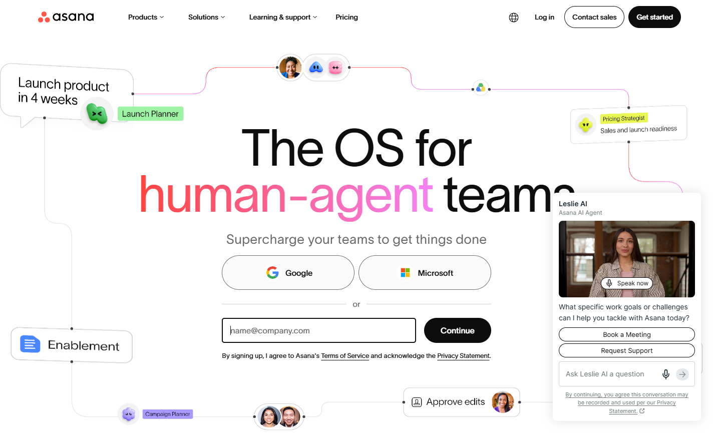 | 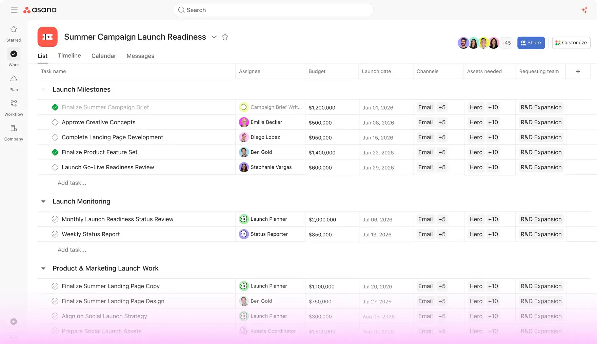 | 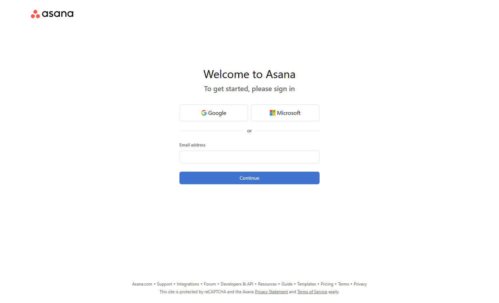 |

全ページ: `evidence/asana/screenshots/full-page.png`（1440×8253）

---

## Toggl

| Home | Reports（公式画像） | Login |
|---|---|---|
| 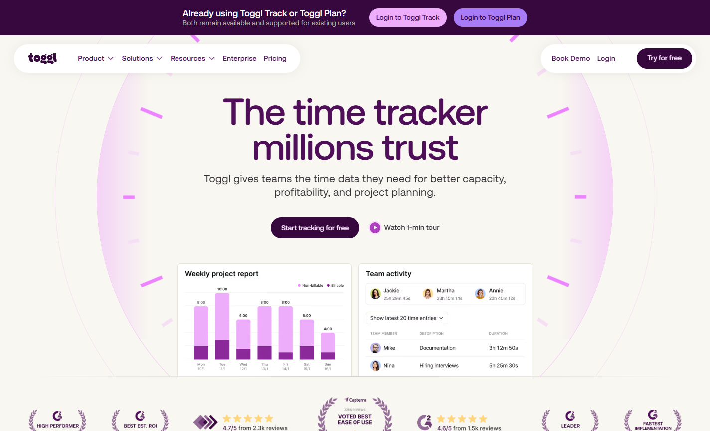 | 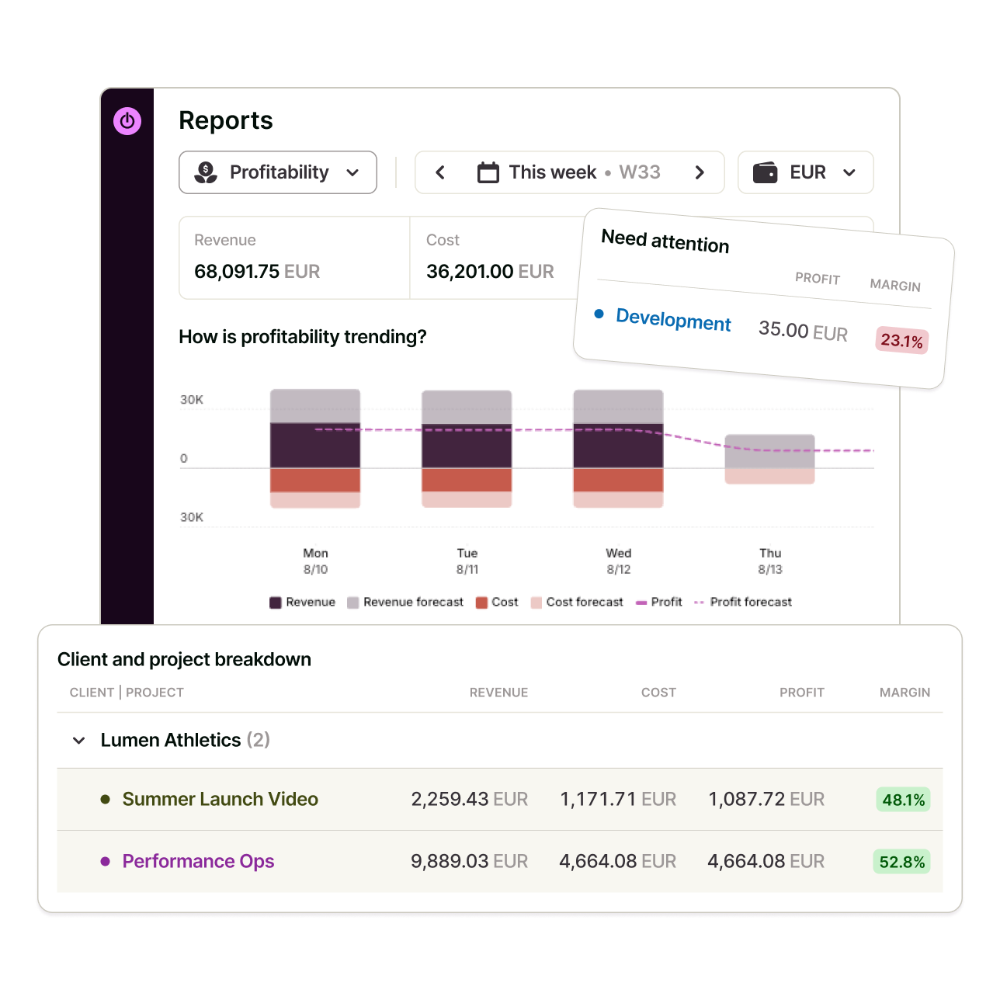 | 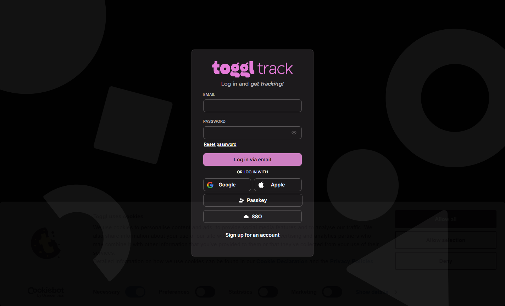 |

全ページ: `evidence/toggl/screenshots/full-page.png`（1440×13619）

---

## Habitica

| Home | Tasks（機能ページ） | Login |
|---|---|---|
| 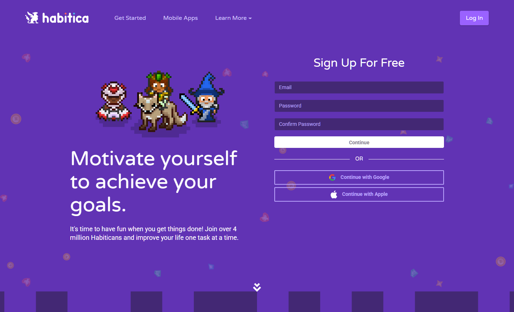 | 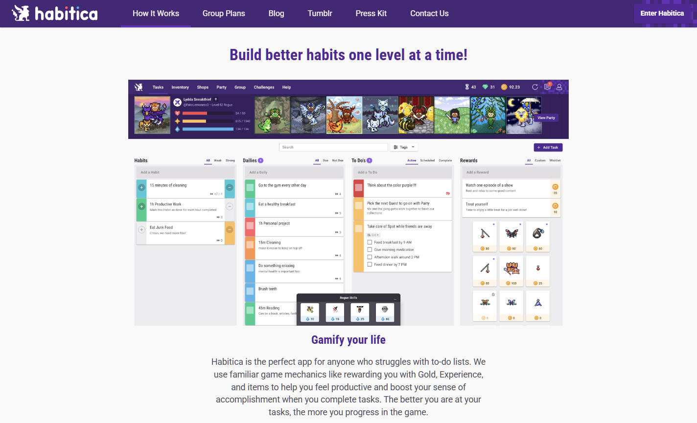 | 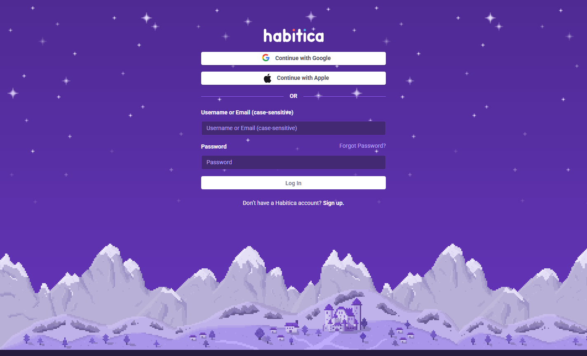 |

全ページ: `evidence/habitica/screenshots/full-page.png`（1440×4545）

---

## Tiimo

| Home | Week view（公式画像） | Sign in |
|---|---|---|
| 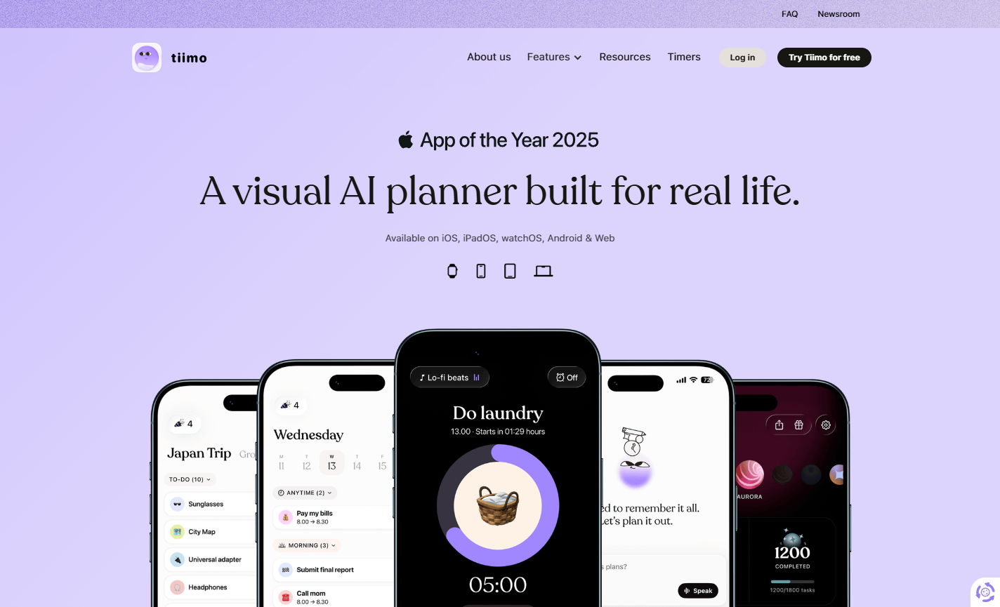 | 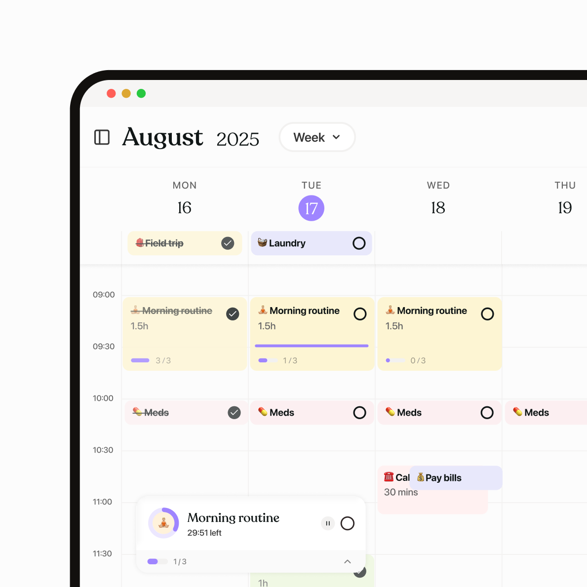 | 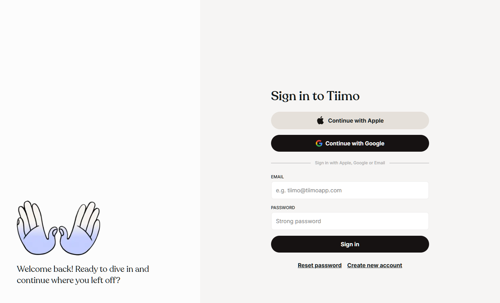 |

全ページ: `evidence/tiimo/screenshots/full-page.png`（1440×8911）

---

## Structured

| Home | Mobile timeline（公式画像） | Login |
|---|---|---|
| 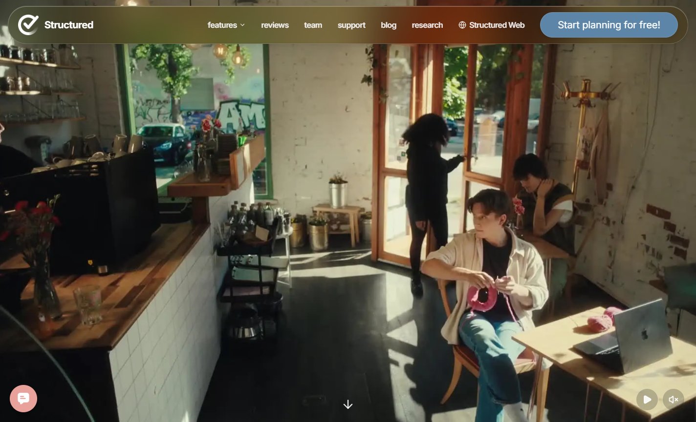 | 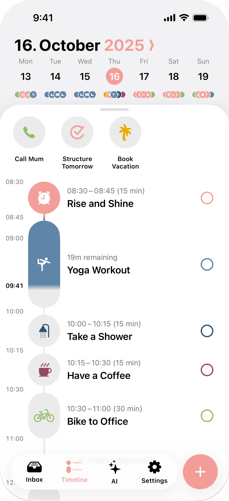 | 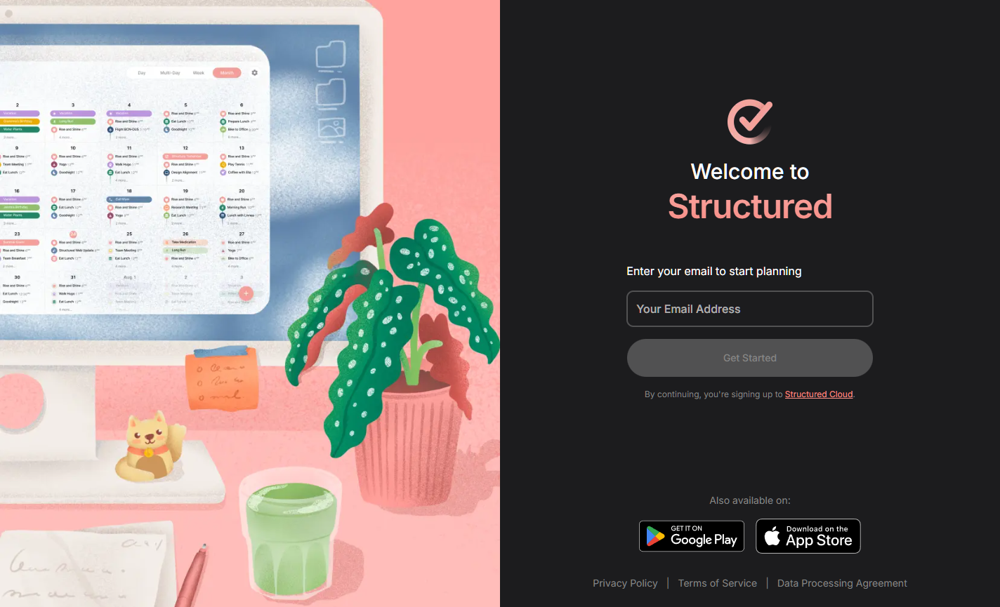 |

全ページ: `evidence/structured/screenshots/full-page-1.png` + `full-page-2.png`（合計 18,168px）

---

## 公式プロダクト画像の一覧

| アプリ | 点数 | 主な内容 |
|---|---|---|
| Asana | 7 | Project list / Task comments + AI / AI teammates dashboard / Memory / Work graph / StackAI / Dark IT ticket |
| Toggl | 5 | Reports / Capacity timeline / Toggl AI / Hero timer ×2 |
| Habitica | 7 | Task list / Habits / Quest / Rewards / Health / School / More |
| Tiimo | 13 | Focus timer / Week routine / Icons / Widgets / AI prompt / AI output / Todo lists ×2 / Desktop week / Mood ×2 / Japan trip |
| Structured | 9 | Full timeline (2402×10672) / Phone / MacBook / Watch / Poster / Features ×3 / Bubble |

すべて `evidence/<app>/product/` に保存。

